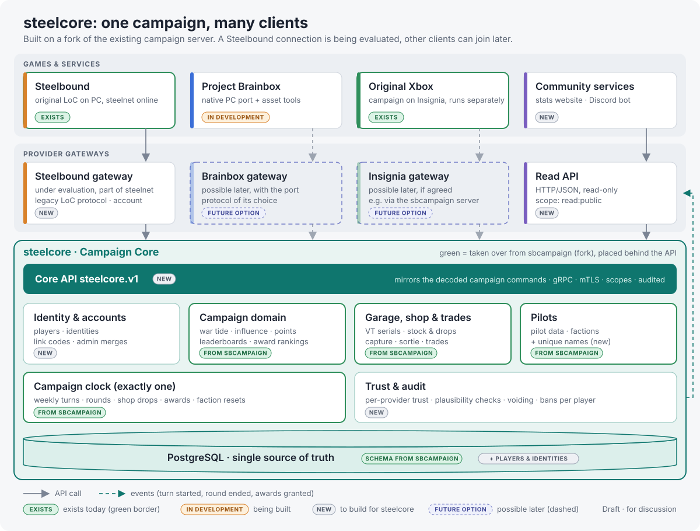

# steelcore

**One Line of Contact campaign for every client.**

A proposed campaign service for *Steel Battalion: Line of Contact*. Players on the original Xbox, on Steelbound and on future clients fight in **one shared campaign**: same war, rounds, leaderboards, awards, garage and shop. **Not crossplay:** matches stay on each platform, only campaign progress is shared.

## The idea

- **Built on what already runs.** `sbcampaign` has decoded the campaign protocol, rebuilt the rules, clock and database, and runs a live campaign on Insignia. steelcore would be a **fork** of it, made only with its author's agreement and a license.
- **Small additions:** player identities and account linking, one Core API in front of the existing logic, per-provider trust, and gateways.
- **Steelbound connects first.** The Insignia campaign keeps running as it is. Connecting it, or a native port, is a later option.
- **Gateways never touch the database.** Rules, clock and anti-cheat live in one place.

## Status

**Concept for discussion.** No code yet. "steelcore" is a working title. Name, license and fork are agreed with the `sbcampaign` author first.

## Documents

| Document | What's in it |
|---|---|
| [Concept](docs/concept.md) | What exists, architecture, the fork plan, identities, linking, API, gateways |
| [FAQ](docs/faq.md) | Short answers for maintainers and players |
| [Decisions (ADRs)](docs/adr/README.md) | Proposed and accepted decisions |
| [Open questions](docs/open-questions.md) | What we still need to decide together |

## Contributing

Ideas are welcome: open an issue or a discussion, or propose an ADR for bigger changes.

**Never** put real player data (XUIDs, account names, pilot data, IP addresses) into issues, examples or tests. Use made-up or cleaned data only.

## License

[AGPL-3.0](LICENSE) for this concept. Gateways connect over the network API and can use their own license.

---

*A community project for game preservation. Not affiliated with Microsoft, Capcom or the Insignia project. Line of Contact and Steel Battalion are trademarks of their respective owners.*
