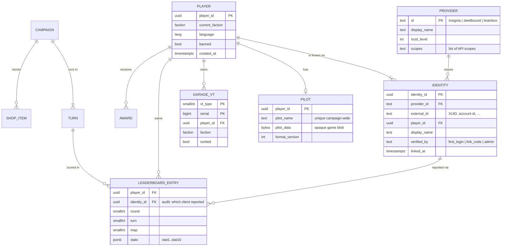
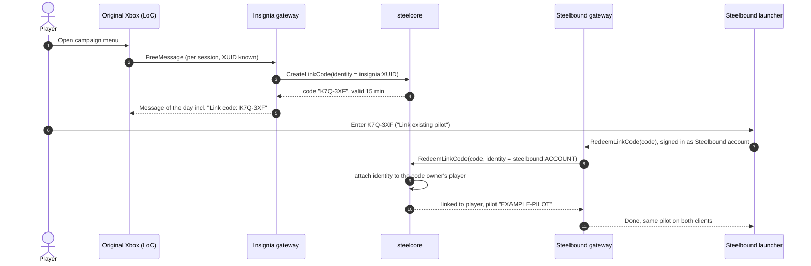
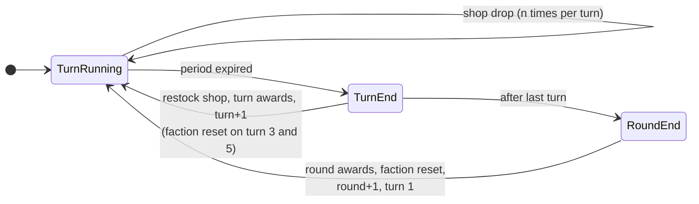
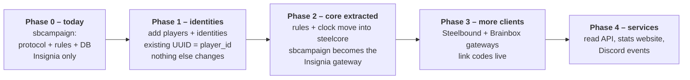

# steelcore: one campaign, many clients

**Status:** Draft concept for discussion · **Scope:** Line of Contact (LoC) online campaign
**Audience:** maintainers of LoC campaign servers, game clients and community services

> This is a proposal, not a finished design. Every decision below is open for discussion. Decisions that are already proposed are recorded as [ADRs](adr/).

---

## 1. Goal

There will soon be several ways to play Line of Contact online:

| Client | How it runs | Online today |
|---|---|---|
| Original Xbox (hardware or emulator) | Original game, online via **Insignia** | Campaign via `sbcampaign` |
| **Steelbound** | Original game in a compatibility layer on PC | Free play (P2P + relays); no campaign yet |
| **Project Brainbox** | Native PC port (new engine) | Planned |
| Future clients and services | Web stats, Discord bot, tools | — |

**steelcore makes all of them take part in one shared campaign.** A player on Steelbound and a player on Insignia fight for their factions in the same war, on the same leaderboards, in the same rounds and turns.

**Not a goal:** crossplay. Matches still happen inside each platform's own networking. Only **campaign state** is shared: points, war tide, awards, garage, shop and pilots.

### Why one campaign

- LoC's campaign needs a lot of players to feel alive. Splitting the community into one campaign per client starves all of them.
- Players move between clients (Xbox today, PC tomorrow). Their pilot and garage should move with them.
- One set of campaign rules, one clock and one moderation team instead of several drifting copies.

---

## 2. Architecture at a glance

Four layers, from the bottom up:

1. **steelcore (Campaign Core):** the only component that holds campaign state and enforces rules. It owns the database and the campaign clock and offers a versioned **Core API**.
2. **Identity & accounts (part of the core):** maps every provider account to one **campaign player**.
3. **Provider gateways:** one per provider (Insignia, Steelbound, Brainbox). A gateway authenticates its own users, speaks whatever protocol its client needs and calls the Core API. The provider runs it.
4. **Games and services:** the clients players actually use, plus read-only consumers such as a stats website.

**The core rule:** gateways never touch the database. Everything goes through the Core API. That is what keeps rules, anti-cheat, auditing and the campaign clock in one place, and lets the schema evolve without breaking every provider at once ([ADR-0001](adr/0001-core-api-only.md)).

---

## 3. Domain model

The core keeps the campaign concepts LoC already has. `sbcampaign` shows them clearly. The one new idea is that the **player**, not the provider account, becomes the owner of everything.

### Players and identities

- A **player** (`player_id`) is the campaign's own idea of a person. Pilot, garage, stats and awards belong to the player.
- An **identity** is one account at one provider: `(insignia, <XUID>)`, `(steelbound, <account id>)`, `(brainbox, <account id>)`. The pair `(provider, external_id)` is unique.
- A player has one or more identities. On first contact a gateway calls `ResolveIdentity`. An unknown identity automatically gets a new player.
- **Existing data keeps its keys.** `sbcampaign` already stores the XUID as a UUID. That exact UUID becomes the `player_id`, and each existing account gets one `insignia` identity. No campaign row has to move ([ADR-0002](adr/0002-player-id-from-existing-uuid.md)).

### Things that must be unique campaign-wide

Several LoC features were designed for one network and become cross-client the moment they share a campaign:

| Feature | Why it matters | Rule |
|---|---|---|
| **Pilot names** | Trading and VT capture look players up by pilot name | The core enforces uniqueness when a pilot is created |
| **VT serials** | Garage entries are `(type, serial)` | Serials come only from the core |
| **Trades** | Two players may be on different clients | Trade tokens are issued and redeemed by the core |
| **Faction resets** | Happen on turn 3, turn 5 and round end | Only the core's clock does this |

### Pilot data

The pilot record is an opaque binary blob produced by the game. Steelbound runs the original game, so it produces the original format automatically. A native port has to read and write **the exact same format**. The core stores the blob as-is with a `format_version` and can validate it with a shared library later. It never needs to understand it in order to run the campaign.

---

## 4. Account linking

A player who already has an Insignia pilot and now starts Steelbound should be able to keep playing as the same pilot. Three ways, in order of preference ([ADR-0003](adr/0003-account-linking.md)):

### 4.1 Link code (default)

The player proves they control **both** accounts. A short-lived code is shown on one side and entered on the other.

**Why the message of the day:** the original game has no field for typing a code, but it asks the server for a free-form message every session. The Insignia gateway knows which XUID is asking, so it can show a personal code. Only someone signed in to that Insignia account can see it. *(To verify: the message length and that it is fetched every session.)*

The reverse direction works too. Any client with its own UI (Steelbound launcher, Brainbox, a web portal) can **show** a code that is then redeemed from another client that has a text field.

### 4.2 Admin merge (fallback)

For accounts that cannot prove ownership the normal way, for example a forgotten Insignia login. A campaign admin merges two players after reviewing the evidence. Every merge is written to the audit log and can be reverted.

### 4.3 Unlinked (always allowed)

Linking is optional. An unlinked Steelbound account is simply a new player in the same campaign.

### Merge rules

Linking an identity to a player that already has progress needs clear rules, otherwise two accounts could be used to farm VTs:

1. **At most one pilot survives.** If both sides have a pilot, the player chooses which one is kept. The other pilot and its garage are archived, not merged.
2. **History is kept, not summed twice.** Old leaderboard rows keep their `identity_id`, so audits and voiding by provider stay possible.
3. **No linking in the last 24 h of a turn** (configurable), so awards cannot be gamed right before the turn ends.
4. **Unlinking** is an admin action. It never duplicates a garage.

---

## 5. Core API

A versioned API (`steelcore.v1`) that mirrors the command groups the original campaign protocol already has. Gateways translate one-to-one. Proposed transport: **gRPC** (typed contracts, server-to-server streaming for events), plus an optional read-only HTTP/JSON API for websites and bots.

| Group | Calls (sketch) | Used by |
|---|---|---|
| Identity | `ResolveIdentity`, `CreateLinkCode`, `RedeemLinkCode`, `ListIdentities` | all gateways |
| War | `GetCampaignState`, `GetWarTide`, `GetWarInfluence`, `GetRoundPoints` | all gateways, read API |
| Missions | `ReportUserPoints`, `ReportMissionPoints`, `AnalyzeMatch` | game gateways |
| Pilot | `GetPilot`, `CreatePilot`, `UpdatePilot`, `DeletePilot`, `SetFaction` | game gateways |
| Garage | `ListVTs`, `AddVTs`, `RemoveVTs`, `CaptureVTs`, `SortieVTs`, `ReturnVTs` | game gateways |
| Shop | `ListShop`, `GetPotentialCost`, `BuyVT` | game gateways |
| Leaderboard | `GetRanks`, `CountRanks` | all, read API |
| Awards | `ListAvailableAwards`, `GetAwardRanks`, `ClaimAward` | game gateways |
| Trading | `CreateTradeToken`, `GetTradePartner`, `ExecuteTrade` | game gateways |
| Messages | `GetMessageOfTheDay(language, provider, identity)` | game gateways |
| Events | `Subscribe(turn_started, round_ended, awards_granted, …)` | gateways, bots |

**Every call carries:** the gateway's credentials (mTLS or signed tokens), the `identity_id` it acts for, and an idempotency key for writes. Gateways get **scopes** (`identity:resolve`, `identity:link`, `campaign:report`, `garage:write`, `read:public`, …), so a stats website can never write.

---

## 6. Trust and anti-cheat

In LoC the **client reports its own results** (`AddUserPoint`, `AddMissionPoint`). With several clients, the core has to decide how much to believe each one.

- **Per-provider trust level.** New providers start low (lower rate limits, results held for review), established ones are trusted more.
- **Plausibility checks in the core:** maximum points per mission and per time window, impossible stat combinations, VT counts that don't add up.
- **Audit log for every write:** gateway, provider, identity, request id. Results can be **voided per provider, per identity or per time range** without touching anyone else.
- **Optional later:** match results signed by the session host or relay, if a provider's networking supports it.
- **Bans** apply to the player, so all linked identities are affected.

---

## 7. Campaign clock

There is exactly **one** campaign clock, in the core ([ADR-0004](adr/0004-single-campaign-clock.md)). It does what `sbcampaign`'s service task does today:

Every transition is published as an **event**, so gateways can refresh caches and a Discord bot can announce "Round 4, Turn 1 has started". The campaign rules (points per turn and round, award VTs per faction, shop drops) live in **one versioned configuration** in the core.

---

## 8. Provider gateways

| Gateway | Client protocol | Authentication | Operated by |
|---|---|---|---|
| **Insignia** | Original LoC campaign protocol (TCP) | Insignia session gives the XUID | Insignia campaign maintainer |
| **Steelbound** | Original LoC campaign protocol, redirected to the Steelbound online service | Steelbound account token | Steelbound |
| **Brainbox** | Its choice: original protocol or a modern API | Brainbox account | Brainbox |
| **Read API** | HTTP/JSON, read-only | none or API key | core operator |

Notes:

- The Insignia and Steelbound gateways speak the **same legacy protocol**. A shared protocol library (codec plus command types) would save both sides work. Whether and how that's possible depends on licensing, see [open questions](open-questions.md).
- The original game expects an **XUID** in places, even when it runs outside Xbox Live. Non-Insignia gateways hand the game a **stable, provider-scoped pseudo-XUID** from a reserved range that cannot collide with real XUIDs. The core never relies on it. Its key is always the `identity_id`.

---

## 9. Data protection

- The core stores **only what the campaign needs:** provider ids, display and pilot names, pilot blobs, stats, garage. **No passwords, no e-mail addresses.** Authentication stays with each provider.
- No logging of player input. Logs contain request metadata only.
- A deletion request removes all of a player's identities and anonymises their history (leaderboard totals stay correct, the name goes away).
- Backups are encrypted, and access to production data is limited to named admins.

---

## 10. Operations (open)

**Who runs the core is deliberately left open** and will be agreed between the maintainers. The concept only defines the roles:

| Role | Responsibility |
|---|---|
| **Core operator** | Runs core and database: backups with point-in-time recovery, monitoring, upgrades |
| **Gateway operator** | Runs one gateway, holds its credentials, handles that provider's users |
| **Campaign admins** | Moderation, merges, voiding results, campaign configuration; drawn from all providers |
| **Maintainers** | Review changes to the core and API in this repository (ADRs for bigger decisions) |

Options range from "an existing campaign database becomes the core" to "shared, neutral infrastructure with admin access for all providers". Requirements are the same either way: one Postgres primary, encrypted backups, a status page and documented restore drills.

---

## 11. Migration path

- **Phase 1** is small and safe. It is a schema addition with a backfill, and existing gateways keep working.
- **Phase 2** is the real work. Domain logic is pulled out of the protocol server, and both sides are tested against the same campaign replays.
- Each phase can be released and rolled back on its own.

---

## 12. Multiple games and campaigns

The design starts with **one LoC campaign**, but no table assumes that:

- `campaign_id` on campaign-scoped data allows parallel or seasonal campaigns (for example a test campaign, or a reset season).
- `provider` and `title` are separate concepts. A future title could use the same identity and account layer with its own domain module.
- Game regions (US, EU, JP) already share one campaign today (English and Japanese messages exist). The pilot-blob format must stay compatible across regions and clients.

---

## 13. Next steps

1. Discuss this draft with the Insignia campaign maintainer and agree on the [open questions](open-questions.md).
2. Agree on the identity schema (Phase 1) and the `steelcore.v1` API contract.
3. Decide on operations and the shared protocol library.
4. Build a prototype core against a copy of the campaign data. Only cleaned or synthetic test data, never real player data in the repository.

---

*steelcore is a community project for game preservation. It is not affiliated with Microsoft, Capcom or the Insignia project. Line of Contact and Steel Battalion are trademarks of their respective owners. This concept builds on what `sbcampaign` showed about the LoC campaign. It contains no code from it.*
