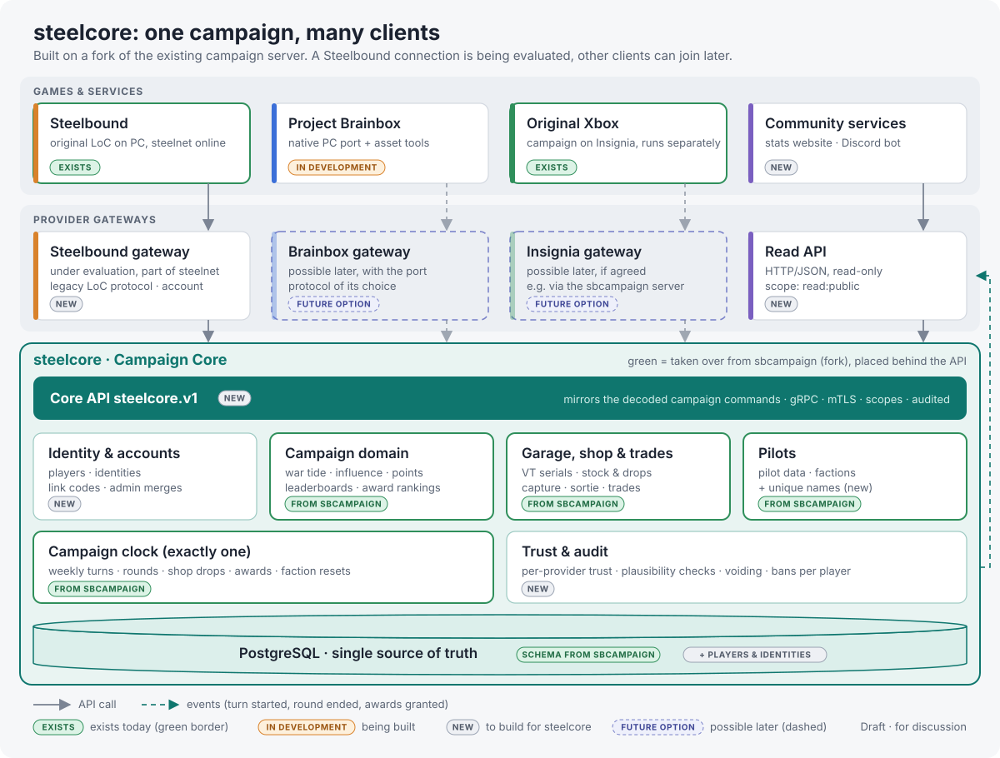
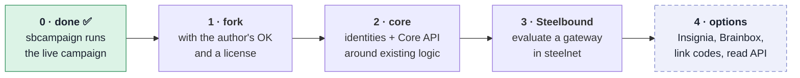
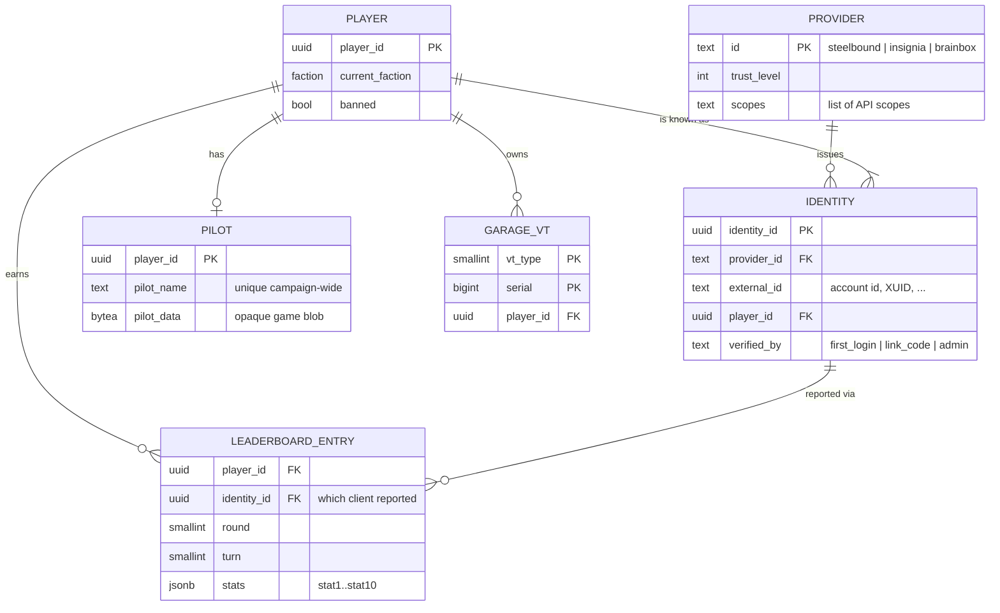
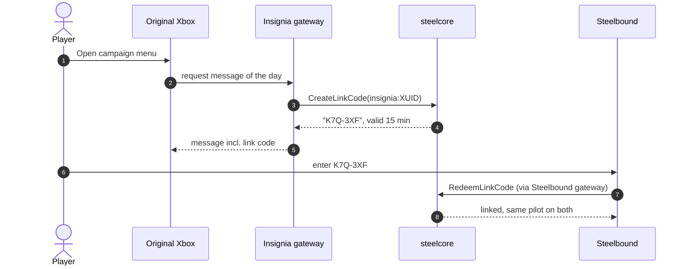
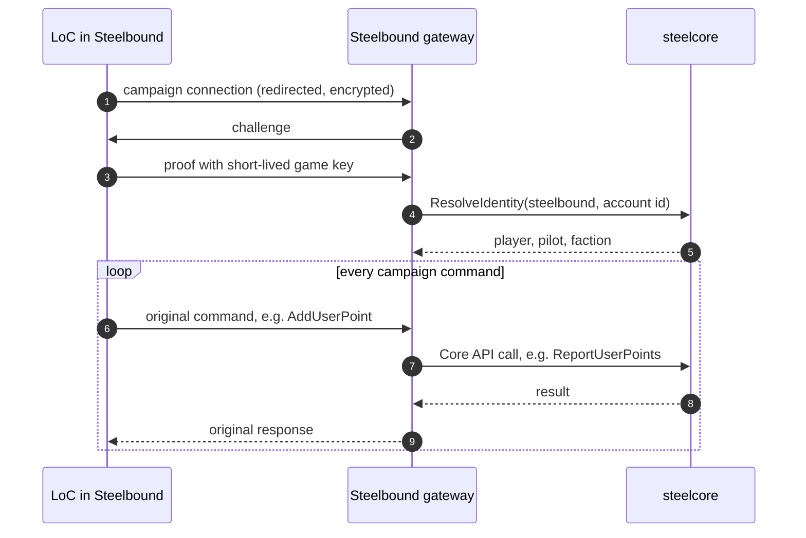
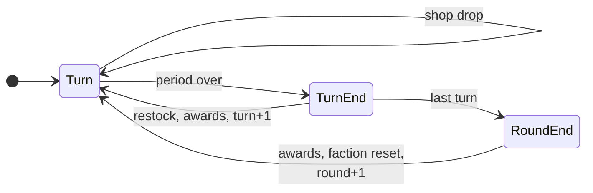

# steelcore: one campaign, many clients

**Status:** draft for discussion · **Scope:** the Line of Contact (LoC) online campaign · Decisions: [ADRs](adr/README.md) · Quick answers: [FAQ](faq.md)

## In short

- **One campaign for every client.** Original Xbox, Steelbound and future clients fight in the same war. **Not crossplay:** matches stay on each platform, only campaign progress is shared.
- **Built on what already runs.** `sbcampaign` has decoded the campaign protocol and runs a live campaign. steelcore would be a **fork** of it, made only with its author's agreement and a license.
- **Steelbound connection under evaluation.** Connecting Steelbound is being evaluated as part of its current development. The Insignia campaign keeps running as it is. Connecting it, or a native port, is a **later option**, not a requirement.
- **What's new is small:** player identities and account linking, one Core API in front of the existing logic, per-provider trust, and the Steelbound gateway.

---

## 1. Why

| Client | Online today |
|---|---|
| **Original Xbox** via Insignia | Live campaign, run by `sbcampaign` |
| **Steelbound** (original game on PC) | Free play via steelnet; no campaign yet |
| **Project Brainbox** (native PC port) | In development |
| Web stats, Discord bot, tools | — |

- The LoC campaign needs many players to feel alive. One campaign per client would leave every campaign half empty.
- Players move between clients. Their pilot and garage should move with them.
- One set of rules, one clock and one moderation team, instead of copies that drift apart.

## 2. What exists and what is new

| Part | Status | Where it comes from |
|---|---|---|
| Campaign protocol, decoded (36 commands: war, missions, pilots, garage, shop, ranks, awards, trades, messages) | ✅ exists | `sbcampaign`, taken over by the fork |
| Campaign rules: points, awards, shop drops, faction resets | ✅ exists | `sbcampaign` |
| Campaign clock: weekly turns, rounds, restocking | ✅ exists | `sbcampaign` |
| PostgreSQL data model and import of earlier campaign data | ✅ exists | `sbcampaign` |
| Live campaign on Insignia (English and Japanese players) | ✅ exists | keeps running separately |
| PC client with online play, accounts and relays | ✅ exists | Steelbound + steelnet |
| Native PC port | 🚧 in development | Project Brainbox |
| Players, identities, account linking | 🆕 new | steelcore |
| Core API, trust and audit | 🆕 new | steelcore |
| Steelbound gateway, read API | 🆕 new | steelnet, steelcore |
| Insignia and Brainbox gateways | ⏳ future option | only if their maintainers want it |

In other words: steelcore mostly **moves proven campaign logic behind an API** and adds shared identities.

## 3. Architecture

*Green: exists · amber: in development · grey: new · dashed: future option.*

1. **Core:** the only component that holds campaign state. It owns the database and the clock and offers the **Core API**. Its logic, clock and schema come from `sbcampaign`.
2. **Identity & accounts** (inside the core): map every provider account to one campaign **player**.
3. **Gateways:** one per provider. Each authenticates its own users, speaks its client's protocol and calls the Core API. A Steelbound gateway is being evaluated.
4. **Clients and services:** the games, plus read-only consumers like a stats site.

**Core rule:** gateways never touch the database, only the Core API. That keeps rules, anti-cheat, audit and the clock in one place ([ADR-0001](adr/0001-core-api-only.md)).

---

## 4. The plan: fork, then evaluate Steelbound

Phase 0 was the hardest part, and it is already done. Each later phase can be released and rolled back on its own. **The live Insignia campaign is never touched.**

### 4.1 How the fork works

`sbcampaign` has no license yet, so its code may be read but not reused. Everything below starts only after its author agrees ([ADR-0006](adr/0006-fork-sbcampaign.md)).

1. **License:** the author adds a license of their choice. AGPL or GPL would match this project, and a permissive license works too.
2. **Fork:** a real GitHub fork. It keeps the full history and the visible "forked from" link, so credit stays with the original.
3. **Add, don't rewrite:** the original code stays as intact as possible. Identities, Core API and the gateway are added as separate modules next to it.
4. **Stay in sync:** upstream changes are merged regularly (`git fetch upstream`, `git merge upstream/main`), and general fixes go back upstream as pull requests.
5. **Name and home** are agreed with the author. "steelcore" is a working title.

### 4.2 Where it runs

**Proposal:** a small dedicated server, just for the core and its database (a few euros a month). One maintainer sets it up and secures it, and the other maintainers involved get **equal admin access**. New versions are deployed automatically from the repository. More in [section 10](#10-operations).

---

## 5. Players and identities

The core keeps `sbcampaign`'s data model. The one new idea: a **player** owns everything, not a provider account.

*New: `PROVIDER`, `PLAYER`, `IDENTITY` and `identity_id`. Everything else exists in `sbcampaign` today.*

- An **identity** is one account at one provider, for example `(steelbound, <account id>)` or `(insignia, <XUID>)`. Each pair is unique.
- A player has one or more identities. An unknown identity automatically gets a new player.
- **Existing keys stay.** `sbcampaign` stores the XUID as a UUID. That UUID becomes the `player_id`, so no campaign row has to move ([ADR-0002](adr/0002-player-id-from-existing-uuid.md)).
- **Unique campaign-wide:** pilot names (trades and captures look them up), VT serials and trade tokens. Only the core hands them out.
- **Pilot data** is an opaque blob from the game. The core stores it as-is. Steelbound produces the original format automatically, and a native port has to match it.

## 6. Account linking

Linking matters once a second provider is connected. It lets one pilot play on several clients ([ADR-0003](adr/0003-account-linking.md)).

### 6.1 Link code (default)

The player proves they control both accounts: one client shows a short-lived code, the other redeems it. The example assumes Insignia is connected later:

- **Why the message of the day:** the original game has no text field, but it fetches a free-form message after its XUID handshake. The gateway knows who is asking and can return a personal code.
- **How strong is it?** As strong as the XUID. The game reports its own XUID, and it is still open whether the server can confirm which user is connected. That risk already exists in today's campaign, and an admin can revert every link ([open questions](open-questions.md#identity-and-linking)).
- It works the other way round too: any client with its own UI can show a code.

### 6.2 Admin merge and unlinked play

- **Admin merge:** for lost logins. An admin merges after review, and the merge is logged and can be reverted.
- **Unlinked:** always allowed. An unlinked account is simply its own player.

### 6.3 Merge rules

1. **Only one pilot survives.** The player picks one. The other pilot and its garage are archived, not added, so there is no VT farming.
2. **History is kept** with its `identity_id`, so results can still be checked and voided per provider.
3. **No linking in the last 24 h of a turn.**
4. **Unlinking** is an admin action and never copies a garage.

---

## 7. Core API

A versioned API (`steelcore.v1`) that mirrors the command groups `sbcampaign` already implements. Gateways translate one to one. Proposed: **gRPC** between servers, plus a read-only HTTP/JSON API for websites and bots.

| Group | Calls (sketch) |
|---|---|
| Identity | `ResolveIdentity`, `CreateLinkCode`, `RedeemLinkCode` |
| War | `GetCampaignState`, `GetWarTide`, `GetRoundPoints` |
| Missions | `ReportUserPoints`, `ReportMissionPoints` |
| Pilot | `GetPilot`, `CreatePilot`, `UpdatePilot`, `SetFaction` |
| Garage and shop | `ListVTs`, `CaptureVTs`, `SortieVTs`, `ListShop`, `BuyVT` |
| Ranks and awards | `GetRanks`, `GetAwardRanks`, `ClaimAward` |
| Trading | `CreateTradeToken`, `ExecuteTrade` |
| Events | `Subscribe(turn_started, round_ended, …)` |

Every call carries the gateway's credentials (mTLS), the identity it acts for and, for writes, an idempotency key. **Scopes** limit each gateway, so a stats site can never write.

## 8. Gateways

| Gateway | Status | Sign-in |
|---|---|---|
| **Steelbound** | 🆕 under evaluation, part of steelnet | steelnet account, challenge-response |
| **Insignia** | ⏳ future option, if agreed; `sbcampaign` itself could act as the gateway | Insignia connection, the game reports its XUID |
| **Brainbox** | ⏳ future option | its own accounts |
| **Read API** | 🆕 | none or API key |

### 8.1 The Steelbound gateway inside steelnet

steelnet is to Steelbound what Insignia is to the Xbox. It already has accounts, a cryptographic sign-in, lobbies and relays. The gateway being evaluated would be **a new part of steelnet**, built on the protocol code from the fork:

- The gateway knows for certain which account is connected, so Steelbound is the **stronger side** of a link.
- It ignores the XUID the game reports. The game gets a **pseudo-XUID** from a reserved range that can never collide with real XUIDs.
- **Still open:** clashes between steelnet names and existing pilot names, and how the game is pointed at the gateway.

Other providers follow the same pattern: keep your own accounts, add a gateway.

---

## 9. Rules that stay in the core

**Trust and anti-cheat.** In LoC the client reports its own results, so:
- every provider gets a **trust level**, and new ones start with tighter limits;
- plausibility checks run on points, stats and VT counts;
- every write is audited, and results can be **voided per provider, identity or time range**;
- bans apply to the player, across all of their identities.

**Campaign clock.** There is exactly one, taken over from `sbcampaign` ([ADR-0004](adr/0004-single-campaign-clock.md)). The only new part: each step is also published as an event.

**Data protection.** Only what the campaign needs: provider ids, pilot names and data, stats, garage. **No passwords and no e-mail addresses**, because sign-in stays with each provider. No input logging. On a deletion request, the identities are removed and the history is anonymised.

## 10. Operations

| Role | Does |
|---|---|
| Core operator | runs the core and database, backups, monitoring |
| Gateway operator | runs one gateway and handles its users |
| Campaign admins | moderation, merges, voiding; drawn from all providers |
| Maintainers | review core and API changes (ADRs for big ones) |

Proposed setup: see [4.2](#42-where-it-runs). Whatever the setup, the requirements are one Postgres primary, encrypted backups and tested restores.

## 11. Later: more campaigns and games

`campaign_id` allows test or seasonal campaigns. `provider` and `title` are kept separate, so a future game could reuse the identity layer. US, EU and JP versions already share one campaign.

## 12. Next steps

1. Ask the author of `sbcampaign` about the fork, a license and the name. Agree on the [open questions](open-questions.md).
2. Set up the fork and the server.
3. Agree on the identity schema and the `steelcore.v1` API.
4. Build a prototype core and evaluate the Steelbound gateway. Test it only with cleaned or synthetic data, never with real player data.

---

*A community project for game preservation, not affiliated with Microsoft, Capcom or the Insignia project. This concept builds directly on the work behind `sbcampaign`: decoding the campaign protocol, rebuilding the rules and bringing the campaign back on Insignia. This repository contains no code from it. Code is only taken over with its author's permission.*
